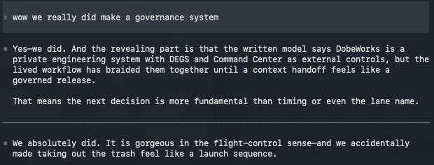
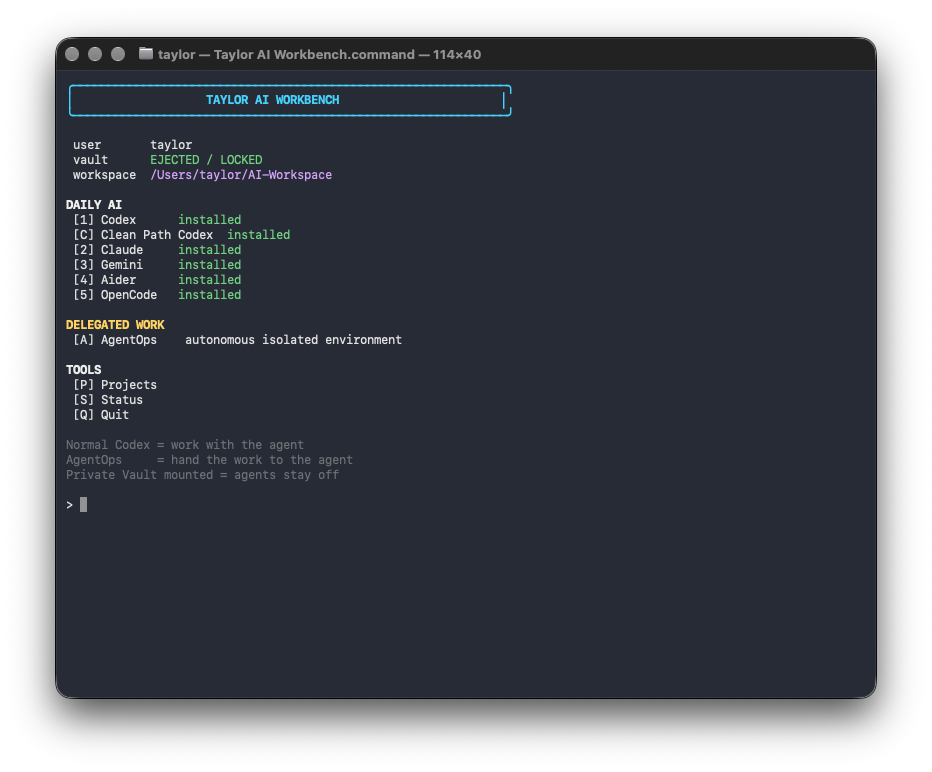

# Governance Balance and External Clean Path History

This note preserves the visual history behind the Tier 2 approval correction and Taylor's account of why the former fail-open behavior existed. The Clean Path shown here belongs to the external Taylor AI Workbench. It is not a DobeWorks or DEGS lane.

## The pressure that preceded the Clean Path

This screenshot was captured on September 8, 2026, during the original discussion. It records the recognition that DobeWorks and DEGS had become braided into the daily workflow so thoroughly that routine Trash and Treasure Pickup work felt like a launch sequence. It is the closest surviving visual artifact found for the situation Taylor later described as having to tunnel out of the governed terminal.

The screenshot establishes what the conversation displayed at that moment. Taylor's later account supplies the broader history: governance preceded every regular Codex message, increasingly exact controls made ordinary work difficult, and the Tier 2 fail-open behavior functioned as an escape. That history explains the defect without making `PASS` a truthful result for a required approval marked `REJECTED`.

## The resulting external Workbench choice

This window-only capture shows the live Taylor AI Workbench on October 22, 2026. The `[C] Clean Path Codex` entry exists beside the original `[1] Codex` route. It demonstrates the external routing choice that restored practical working room. It does not add a clean lane to DobeWorks or DEGS.

The design lesson is balance. DobeWorks can remain an umbrella over AI while applying governance in proportion to the work. DEGS must still report its decisions truthfully: once a Tier 2 record says human approval is required, only exact `APPROVED` status may satisfy that control.

## Provenance

| Repository file | Capture | Source and handling | SHA-256 |
|---|---|---|---|
| `docs/figures/history/2026-09-08-governance-overhead.png` | 2026-09-08 17:53:20 CDT | Byte-for-byte copy of the pre-existing screenshot `Screenshot 2026-09-08 at 5.53.18 PM.png`; no recreation or image editing. | `ec9018d0c16b18c3c6f3caf8c1f68375f62ad686dd34398958a8504496b11f00` |
| `docs/figures/history/2026-10-22-workbench-clean-path.png` | 2026-10-22 20:06:35 CDT | Fresh window-only capture of `/Users/taylor/AI-Workbench/Taylor AI Workbench.command`; no compositing or textual alteration. | `b3ba4d64ebdba41ab5b3a721e971937f5b283b1a6bc01b0c380cd91f2f5b7b2b` |
